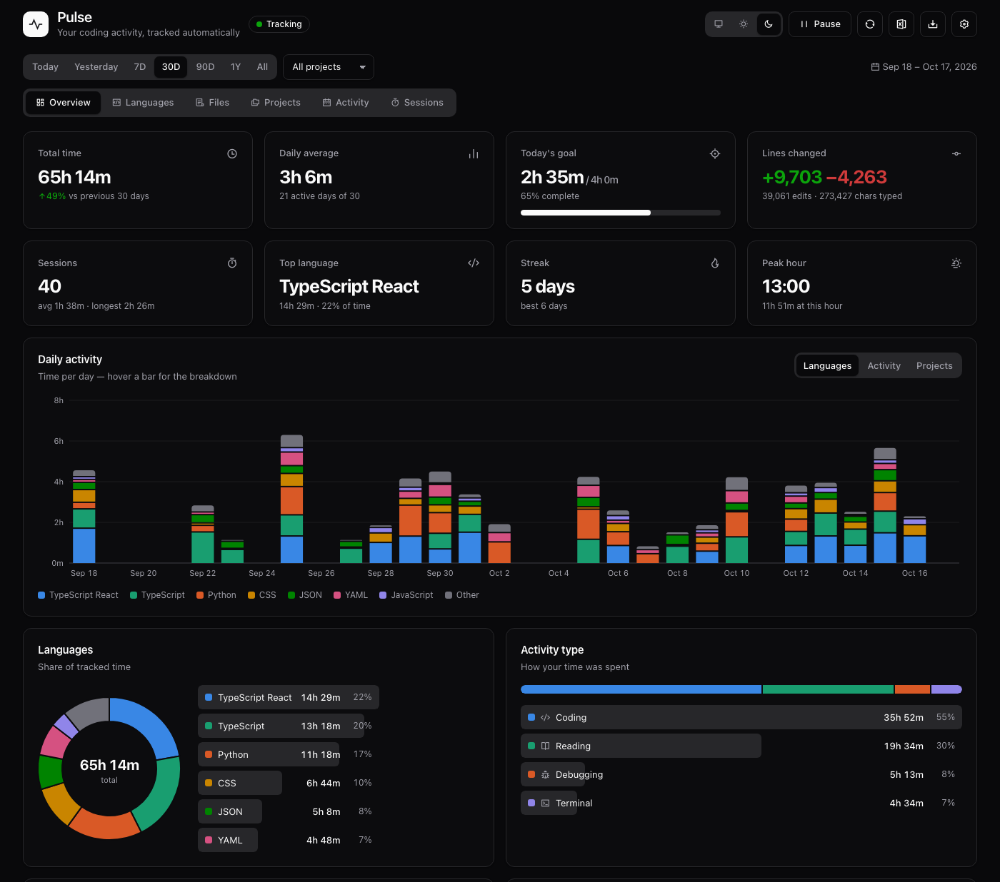
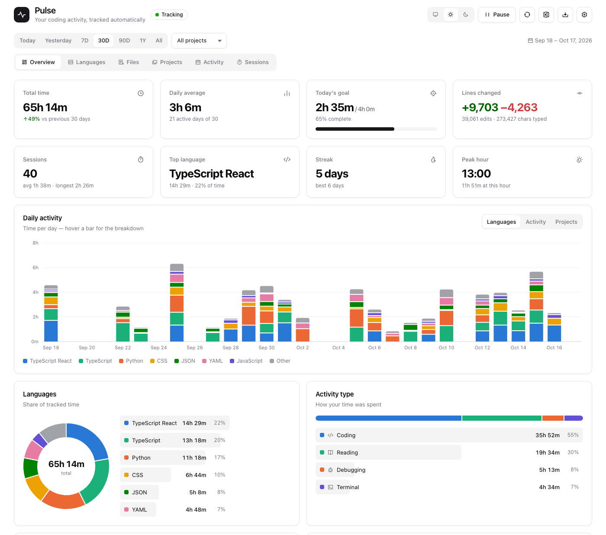
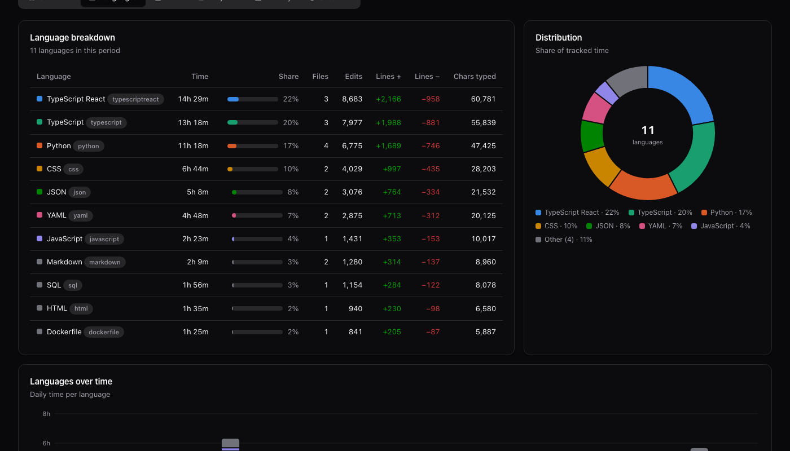
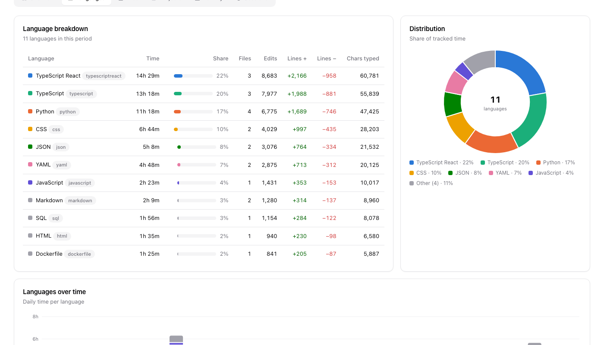
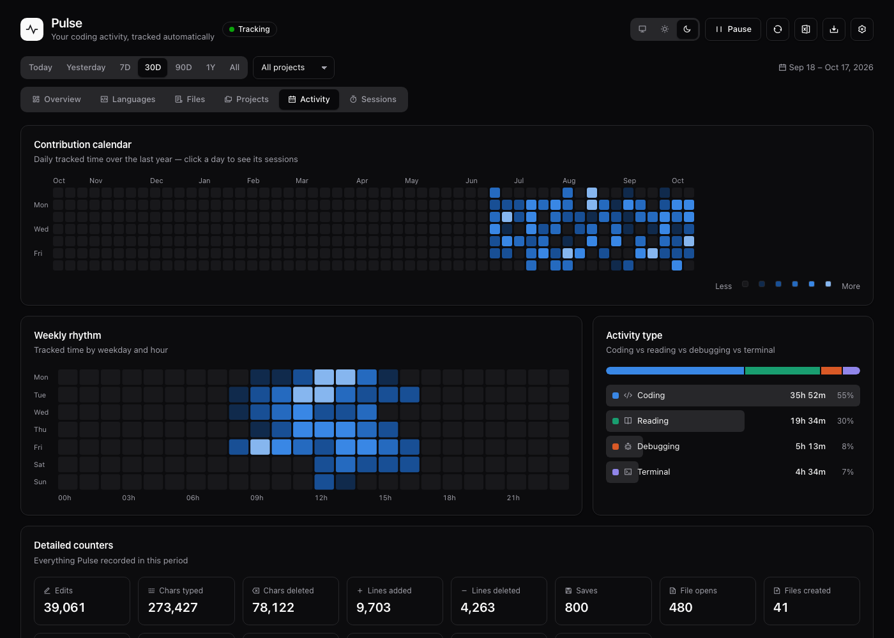
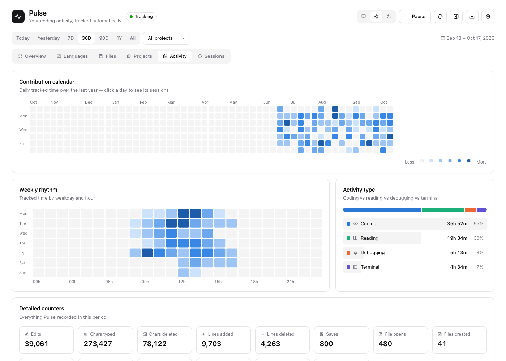
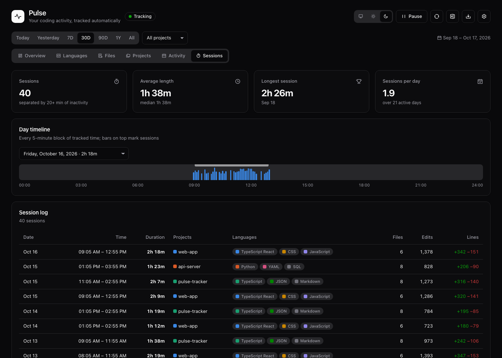
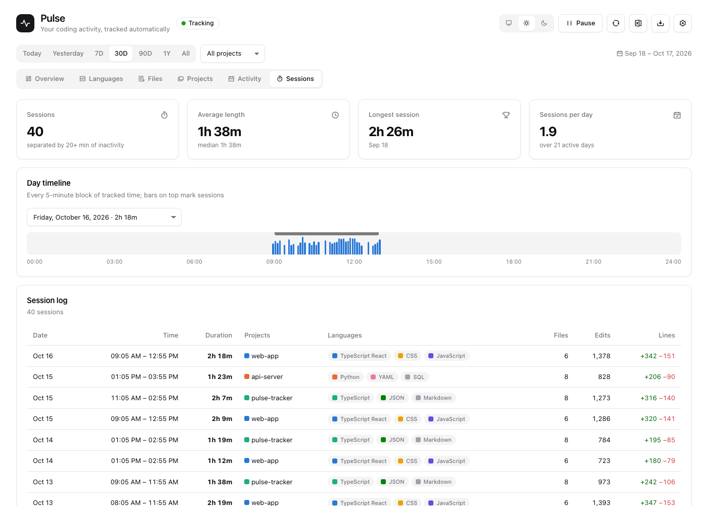

# Pulse — Time Tracker for VS Code

Automatic, detailed coding time tracking with idle detection and a shadcn-style dashboard, in light and dark themes.

## Screenshots

| Dark | Light |
|---|---|
|  |  |
|  |  |
|  |  |

## How tracking works

- **Starts automatically** the moment you type in a file. There is nothing to start or stop.
- **Activity signals:** typing, cursor moves, scrolling, switching files, saving, terminal commands, debugging, and git commits.
- **Idle detection:** after **20 minutes** with no activity (configurable), the session is closed at your *last* activity, so idle time is never counted. Your next keystroke starts a new session.
- Only the **focused** window records time, so two open windows never double-count. This is configurable.
- Time is split into 5-minute blocks, so hours, days and midnight boundaries are attributed correctly.

### What gets recorded

| Dimension | Details |
|---|---|
| Time | per file, language, project (workspace folder), git branch, hour, 5-minute block |
| Activity type | coding (editing), reading (navigating/scrolling), debugging, terminal |
| Edits | edit count, lines added/deleted, characters typed/deleted (per file & language) |
| Files | opens, saves, created / deleted / renamed |
| Other | git commits, debug sessions, terminal commands |
| Sessions | start/end, active time, projects, languages, files touched, edits |

## Dashboard

Open it with **Pulse: Open Dashboard**, or click the timer in the status bar.

- **Overview:** KPIs (total, daily average, today's goal, lines changed, sessions, top language, streak, peak hour); daily or hourly stacked chart by language, activity type or project; language donut; activity types; top files; projects; time of day; branches.
- **Languages:** detailed table, distribution donut, languages over time.
- **Files:** searchable, sortable table of every file. Click a file to open it.
- **Projects:** per-project stats, projects over time, branches.
- **Activity:** GitHub-style yearly calendar, weekday × hour heatmap, all counters.
- **Sessions:** a timeline of each day's 5-minute blocks, and a full session log.
- **Filters:** Today / Yesterday / 7D / 30D / 90D / 1Y / All, a project filter, and comparison with the previous period.
- **Theme:** System (follows VS Code) / Light / Dark.

## Commands

- `Pulse: Open Dashboard`
- `Pulse: Pause / Resume Tracking`
- `Pulse: Show Today's Summary`
- `Pulse: Export Data (JSON)` / `Pulse: Export Files Report (CSV)`
- `Pulse: Open Data Folder`
- `Pulse: Delete All Tracked Data`

## Settings

| Setting | Default | |
|---|---|---|
| `pulse.idleTimeoutMinutes` | `20` | Minutes of inactivity before tracking stops |
| `pulse.trackWhenUnfocused` | `false` | Keep counting while VS Code is in the background |
| `pulse.dailyGoalHours` | `4` | Daily goal shown in the status bar and dashboard |
| `pulse.showStatusBar` | `true` | Show today's time in the status bar |
| `pulse.excludePatterns` | `node_modules`, `.git` | Glob patterns that are never tracked |

## Privacy

All data stays on your machine as JSON files in VS Code's global storage (`Pulse: Open Data Folder`). Nothing is sent anywhere.
